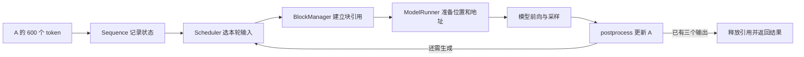

# 01：单个请求的完整推理流程

[目录](README.md) · [下一篇：模型前向计算与 token 采样](02-one-model-step.md)

本篇以请求 A 为例，分析从输入 600 个 token 到生成三个输出的完整流程，重点说明请求入队、调度、KV 进度和结果返回。模型前向在本篇中作为预测下一个 token 的函数，其内部计算在下一篇展开。

## 1. 请求输入与生成参数

```python
prompt_a = [42] * 512 + [43] * 88
params = SamplingParams(temperature=0.6, max_tokens=3, ignore_eos=True)
```

这里的 42、43 是 token 在词表中的编号。`[42] * 512` 表示将编号 42 重复 512 次，`[43] * 88` 表示将编号 43 重复 88 次，`+` 将两段列表拼接成 600 个输入 token。

`max_tokens=3` 单独规定输出数量，输出记为 Y1、Y2、Y3。EOS 是表示生成结束的特殊 token；`ignore_eos=True` 表示忽略这个停止条件，使本例按三个输出结束。`temperature=0.6` 调整采样概率分布，不改变请求的输入长度，计算方式在第二篇说明。

模型处理每个输入位置时，会在各层计算用于 Attention 的 K、V 向量。保存这些向量的空间称为 **KV Cache**，后续生成可以复用它们。**Prefill** 处理已有输入，本例第一次处理 600 个 token；**Decode** 则在后续每步输入上次生成的一个 token，预测下一个 token。

<a id="engine-parameters"></a>

本例使用单卡，另外四个引擎参数分别控制不同的事情：

| 参数与本例取值 | 含义 | 对 A 的影响 |
| --- | --- | --- |
| `enforce_eager=True` | 关闭执行器的 CUDA Graph，即不使用预先记录的 GPU 操作序列进行重放；局部 `torch.compile` 仍然存在 | 每步通过普通模型调用执行前向 |
| `max_num_batched_tokens=1024` | 一轮 Prefill 中，所有被选请求的新输入 token 数之和最多为 1024；本实现的 Decode 分支不检查这个预算 | A 有 600 个输入，可在一轮内处理完；没有要求补齐到 1024 |
| `max_model_len=1024` | 引擎配置的单条序列长度上限，按原始输入与生成内容的总长度理解；还受模型配置约束 | A 最终总长为 `600+3=603`，在这个范围内 |
| `max_num_seqs=16` | 一轮调度最多选择 16 条请求；不限制整个等待队列的长度，也不是全局活跃请求上限 | 本例只有 A，一轮只选择一条 |

`max_model_len` 在这份实现中用于预热规模和图缓冲区尺寸等，**并没有形成完整的请求长度检查或超长自动停止机制**。两个参数都取 1024 只是本例的设置：一个限制每轮新输入量，另一个描述单条序列的长度，两者可以不同。

KV 块大小取源码默认值 256，即每个块能保存 256 个 token 位置在各层的 K/V。本例假设池容量足够，初始没有可复用的前缀缓存。

下面是完整时间线。KV 进度表示已经处理了多少个位置，表中数值均在本步 CPU 后处理完成后读取：

| 时刻 | 本轮输入模型什么 | A 已知 token 数 | A 的 KV 进度 | 已生成数量 |
| --- | --- | ---: | ---: | ---: |
| 刚入队 | 尚未运行 | 600 | 0 | 0 |
| 第 1 步：Prefill | 原始 600 个输入 | 601 | 600 | 1 |
| 第 2 步：Decode | Y1 | 602 | 601 | 2 |
| 第 3 步：Decode | Y2 | 603 | 0，结束时已释放 | 3 |

第三步释放前实际算好了 602 个位置的 KV。最后的 Y3 不再输入模型，因为任务已经结束，无须用它预测 Y4。

## 2. generate 接口与执行循环

从接口看，A 的输入和生成要求由一次 `generate()` 调用表达。这里用 `llm` 代表引擎对象：

```python
outputs = llm.generate([prompt_a], params, use_tqdm=False)
```

`[prompt_a]` 是只含一条请求的列表，`params` 规定采样温度和输出数量。`generate()` 先把 A 加入队列，再反复调用 `step()`，直到请求完成。`use_tqdm=False` 只影响进度条。

对本例而言，一次接口调用内部包含三步模型执行：600 个输入产生 Y1，Y1 产生 Y2，Y2 产生 Y3。最终 `outputs[0]` 同时包含这三个输出 ID 和它们解码后的文本。下面沿这三步展开，先从引擎创建时准备好的对象开始。

## 3. 请求入队前的引擎初始化

[`LLM`](../nanovllm/llm.py) 只是 `LLMEngine` 的子类，因此初始化从 [`LLMEngine.__init__()`](../nanovllm/engine/llm_engine.py) 开始。

初始化发生在 A 入队之前，主要步骤如下：

```text
模型目录和参数
  → Config 读取模型配置，确定引擎采用的序列长度上限
  → Sequence.block_size = 256
  → ModelRunner 初始化 GPU 通信组，选择设备并构建 Qwen3
  → 从 safetensors 加载权重
  → warmup_model()：构造临时 token 列表，执行一次 Prefill 预热
  → allocate_kv_cache()：估算块数并申请 GPU KV 存储空间
  → 创建 tokenizer，设置 EOS，创建 Scheduler
```

<a id="model-position-limit"></a>

### 模型配置中的位置上限

HF 指 Hugging Face；这里是通过 `AutoConfig` 读取模型目录里的配置。配置包含层数、隐藏维度，以及 `max_position_embeddings` 等字段。

“位置”是 token 在序列中的编号，从 0 开始。A 的 600 个输入位于 0—599，Y1 位于 600，Y2 位于 601。`max_position_embeddings` 是模型配置声明的位置数量上限；例如该值为 4096，位置编号范围就是 0—4095。

本实现按这个字段创建 RoPE 位置编码表，并在 [`Config`](../nanovllm/config.py) 中执行：

```python
self.max_model_len = min(
    self.max_model_len,
    self.hf_config.max_position_embeddings,
)
```

若引擎指定 1024、模型声明 4096，最终采用 1024；若模型只声明 512，则最终采用 512，这时本篇 600-token 输入的案例条件就不成立。这里描述的是配置和位置表的范围，不保证模型在所有长度上都有相同的生成质量。

### GPU 通信组与 rank

NCCL 是 **NVIDIA Collective Communications Library**，即 NVIDIA 的 GPU 集合通信库。多卡计算需要把各卡的部分结果求和或收集到一张卡，NCCL 提供这类通信操作。

`rank` 是进程在通信组中的编号，`world_size` 是组内进程数。当前代码让每个执行进程使用一张 GPU；本例只有一个进程，编号为 rank 0，`world_size=1`。源码仍调用 `dist.init_process_group("nccl", ...)` 建立单成员通信组，以统一单卡和多卡的执行接口。本例不涉及两张 GPU 之间的数据交换。

<a id="warmup"></a>

### 预热输入的长度如何确定

`warmup_model()` 在正式请求到来前，构造临时输入并执行一次 Prefill。源码中的“合成输入”具体就是 `[0] * seq_len`：用编号 0 填充的 token 列表，不是用户文本，也不是模型生成的内容。这里的 0 不一定表示 tokenizer 的 padding token。

这次前向用于预先执行计算路径，并记录临时张量的显存峰值，供后面的 KV 容量估算使用。本例假设模型配置允许至少 1024 个位置，因此两个生效参数均为 1024：

```text
每轮 Prefill token 预算 max_num_batched_tokens = 1024
单条序列长度配置       max_model_len          = 1024
每轮请求数上限         max_num_seqs           = 16

每条预热输入的长度 seq_len = min(1024, 1024) = 1024
预热请求数 num_seqs       = min(1024 // 1024, 16) = 1
临时输入                 = [0] * 1024
```

前两个 1024 是不同参数的取值，第三个是由它们计算出的预热输入长度。若仅把 Prefill 预算改为 256，单条长度配置仍为 1024，则预热输入长 `min(256,1024)=256`。这些临时输入与 A 的 600 个输入相互独立。

预热发生在 KV 池分配前，各层的缓存张量仍为空。因此 Attention 跳过写缓存，直接使用本次前向算出的 K/V；这次调用的采样结果也不会追加到 A。它没有给 A 生成第一个输出。

<a id="kv-pool"></a>

### KV 池何时占用显存

`allocate_kv_cache()` 先读取设备已用显存和预热记录的峰值，估算池容量，再通过 `torch.empty(...)` 为整个 KV 池分配 **GPU 存储空间**。执行器此前已将默认设备设为 CUDA，所以这里创建的是 GPU 张量。`empty` 表示不初始化其中的数据，并不表示没有分配内存。

因此，**A 尚未入队时，KV 池就已经占用显存**。例如某时刻设备剩余 12 GiB，随后池从设备取得 8 GiB，忽略其他变化，剩余量就降到约 4 GiB。若 PyTorch 分配器复用已保留的显存，设备层面的剩余量未必恰好在这一行下降，但这块存储在此前就已经被进程占用。

后面给 A 分配三个块，是从这个已存在的池中分配使用权、记录块号，不是再次向 GPU 申请同等大小的 KV 存储；写入 K/V 则让这些位置具有有效内容。请求结束时归还块引用，池本身仍保留。容量公式见[第三篇](03-batching-and-cache.md#capacity)。

本例的 `enforce_eager=True` 跳过 CUDA Graph 捕获；开启图时，捕获发生在 KV 池分配之后，相关机制见第四篇。

## 4. Sequence 对象与入队状态

`generate()` 调用 `add_request(prompt_a, params)`，再由它构造 [`Sequence`](../nanovllm/engine/sequence.py)。构造函数的 `self.token_ids = copy(token_ids)` 将 `prompt_a` 的 600 个编号复制到请求对象中。若原始输入是字符串，则先经过 `tokenizer.encode()` 得到编号列表。

<a id="sequence-state"></a>

入队后的 A 可以写成：

```text
token_ids             = [42 × 512, 43 × 88]   # 此处是重复次数示意
num_tokens            = 600
num_prompt_tokens     = 600
num_cached_tokens     = 0
num_scheduled_tokens  = 0
last_token            = 43
block_table           = []
status                = WAITING
is_prefill            = True
```

`Scheduler.add()` 将 A 放入等待队列，此时 `waiting=[A]`、`running=[]`。A 已持有原始输入列表 `prompt_a` 的副本，输出数量为 0。“已有 token”不代表“已经计算过模型”：这些编号尚未进行前向，所以 A 的有效 KV 数仍为 0。

`Sequence` 保存 CPU 上的 token 列表和状态记录；GPU 池保存模型计算得到的浮点 K/V。前者在构造请求时就存在，后者要等本轮 `run()` 执行后才会写入对应位置。

后续每生成一个 token，`num_tokens` 增长，`num_prompt_tokens` 始终为 600。因此输出切片一直是 `token_ids[600:]`。即使以后 A 被抢占重算，也不会把之前生成的内容重新算作 prompt。

## 5. 第一步：Prefill 生成 Y1

[`LLMEngine.step()`](../nanovllm/engine/llm_engine.py) 的核心只有三句：

```python
seqs, is_prefill = self.scheduler.schedule()
token_ids = self.model_runner.call("run", seqs, is_prefill)
self.scheduler.postprocess(seqs, token_ids, is_prefill)
```

<a id="step-correspondence"></a>

三句代码分别负责选择工作、执行计算、更新 CPU 状态。下面严格按调用顺序对应；`seqs=[A]` 表示本轮只有 A：

| 代码 | 本次返回值 | 调用结束后发生的变化 |
| --- | --- | --- |
| `self.scheduler.schedule()` | `([A], True)` | 预算 1024 可容纳 600 个输入；给 A 分配池内三个块，设置 `A.num_scheduled_tokens=600`，将 A 从 waiting 移到 running，并设为 RUNNING |
| `self.model_runner.call("run", seqs, is_prefill)` | `[Y1]` | A 的输入位置 0—599 已完成模型计算，各层 K/V 已写入池；CPU 的 `A.token_ids` 仍有 600 个编号，`A.num_cached_tokens` 仍为 0 |
| `self.scheduler.postprocess(seqs, token_ids, is_prefill)` | `None` | 登记新完成的完整块，将 `A.num_cached_tokens` 改为 600、`A.num_scheduled_tokens` 清零，再把 Y1 追加到列表，使总长变为 601 |

第一句内部包含队列移动，并不是在三次调用之间又执行了第四个步骤。第二句的 `call("run", ...)` 在本例中通过 `getattr` 找到 `ModelRunner.run()` 并调用它；返回的 `token_ids=[Y1]` 是本轮采样结果，与 `A.token_ids` 保存的整个序列是不同变量。

三个状态字段的含义是：`num_tokens` 统计已有编号的总数，`num_cached_tokens` 记录已完成的 KV 进度，`num_scheduled_tokens` 记录本轮安排处理的 token 数。调度器先填写本轮工作量，模型执行完成后，后处理才把工作量累计到 KV 进度。

假设初始空闲块从 0 排列，A 的块表为 `[0,1,2]`。RUNNING 是调度器在前向前设置的状态，不能单凭这个值推断 KV 已经计算完毕。第一步结束后，Y1 虽然已加入列表，但尚未作为模型输入，因此还没有对应的 KV。

<a id="cache-registration"></a>

这里的“登记完整块”由 `BlockManager.hash_blocks()` 完成。每块容纳 256 个位置，第一步处理 600 个输入后，各块的情况是：

| 物理块 | 已计算的位置 | 本步是否登记为完整块 |
| --- | --- | --- |
| 0 | 0—255，共 256 个 | 是，计算哈希 h0，记录 `h0 → 块 0` |
| 1 | 256—511，共 256 个 | 是，结合前缀计算哈希 h1，记录 `h1 → 块 1` |
| 2 | 512—599，共 88 个 | 否，尚未填满，但这 88 个位置的 KV 可以被 A 使用 |

哈希是根据 token 编号和前缀计算出的查找键。`hash_blocks()` 对每个新完成的块执行：

```python
block.update(h, token_ids)                   # 在 CPU 的 Block 中记录哈希和本块 token
self.hash_to_block_id[h] = block.block_id   # 建立“哈希 → 物理块号”的查找记录
```

这两句就是“登记”。K/V 向量已在 `run()` 中写入 GPU，登记操作只更新 CPU 元数据，供后续请求寻找相同前缀。它也不同于把 `num_cached_tokens` 从 0 增加到 600：一个建立复用索引，一个记录 A 的计算进度。

## 6. 第二步：Decode 输入 Y1 并生成 Y2

如果没有 KV Cache，预测 Y2 时必须重新把 A 的 600 个输入加 Y1 送进模型。现在每层已有前 600 个位置的 K/V，所以这一轮只需为 Y1 计算新 Q/K/V，再用新 Q 查询历史。

[`prepare_decode()`](../nanovllm/engine/model_runner.py) 为 A 准备：

```text
input_ids      = [Y1]
positions      = [600]
context_lens   = [601]
block_tables   = [[0,1,2]]
slot_mapping   = [600]     # 物理块 2 × 256 + 块内偏移 88
```

这里的 `context_lens=601` 包含当前输入 Y1，因为每层先写 Y1 的 KV，再执行 Attention。它不是简单复制前向前的 `num_cached_tokens=600`。

这轮不需要第四个块：位置 600 仍落在第三个逻辑块，块内偏移为 88。写完并采样 Y2 后，CPU 状态变为 `num_tokens=602`、`num_cached_tokens=601`。

<a id="stage-flags"></a>

源码中有三个名为 `is_prefill` 的标志，使用位置不同：

| 标志 | 本轮取 False 后的具体作用 |
| --- | --- |
| `schedule()` 返回的 `is_prefill` | `ModelRunner.run()` 调用 `prepare_decode()`，只打包 Y1 这一行，位置为 600 |
| `Context.is_prefill` | Attention 调用 `flash_attn_with_kvcache()`，用 Y1 的 Q 查询池中的 601 个位置；LM Head 直接处理这一行隐藏状态，计算词表分数 |
| `A.is_prefill` | `Sequence.__getstate__()` 在序列化请求时，用 `last_token=Y1` 替代完整 token 列表；该行为用于多进程执行，本篇单卡不发生这次传输 |

`Context` 是本轮计算的元数据对象，`prepare_decode()` 将其中的标志设为 False。作为对照，第一步 Prefill 时它为 True：Attention 调用 `flash_attn_varlen_func()` 处理 600 行输入；LM Head 只选 A 的最后一行，即位置 599 的隐藏状态，用它预测 Y1。Decode 输入本来就只有一行，因此无需再次选取末行。

`A.is_prefill` 在首次 Decode 调度时由 True 改为 False。若将本例扩展到双卡，主进程仍保存完整的 601 个编号，但发给另一个执行进程的 token 内容只需 Y1：过去 600 个位置的 K/V 已经在各卡保存，不必重新输入旧 token。传输的数据还包括总长度 601、KV 进度 600、本轮工作量 1 和块表，并不是只发送一个数字。跨进程细节见第四篇。

## 7. 第三步：终止条件与结果返回

本步输入 Y2、位置 601。调度后，`A.num_tokens=602`、`A.num_cached_tokens=601`、`A.num_scheduled_tokens=1`。模型计算 Y2 的 KV，并采样得到 Y3；刚返回时，CPU 上这三个字段还没有更新。

<a id="postprocess"></a>

[`Scheduler.postprocess()`](../nanovllm/engine/scheduler.py) 随后执行以下语句。表中的 `seq` 就是 A，`token_id` 就是 Y3：

| 源码操作 | 含义与本次结果 |
| --- | --- |
| `self.block_manager.hash_blocks(seq)` | 检查本轮是否又完成了整个 256-token 块；本步没有新完整块，因此不增加登记记录 |
| `seq.num_cached_tokens += seq.num_scheduled_tokens` | 将本轮已完成的 1 个位置计入 CPU 的 KV 进度：`601+1=602` |
| `seq.num_scheduled_tokens = 0` | 本轮工作已经完成，清空“本轮安排多少个 token”的计数；不会清空 KV 或 token 列表 |
| `seq.append_token(token_id)` | 追加 Y3，使总长变为 603、输出数量变为 3；Y3 尚未计算 KV |
| `seq.status = SequenceStatus.FINISHED` | 输出数量达到 `max_tokens=3`，标记请求完成 |
| `self.block_manager.deallocate(seq)` | 归还池内块引用，清空 A 的块表，并将它的 KV 进度重置为 0 |
| `self.running.remove(seq)` | 从运行队列移除 A |

最后三句位于停止条件分支内；本例达到输出数量上限，因此执行它们。第一句 `hash_blocks()` 使用更新前的进度与本轮工作量确定检查范围，源码中的 `//` 表示整除：

```text
start = 601 // 256       = 2
end   = (601+1) // 256   = 2
start == end，因此直接返回，没有新块需要登记。
```

前两个块在第一步就已经登记。现在第三个块有 `602−512=90` 个有效位置，仍不足 256；这些位置已写好 KV，但尚不属于可登记的完整块。源码先调用 `hash_blocks()`，再累计进度并清零本轮计数，后者不会触发任何 GPU 写入。

归还块引用后，A 的输出 token 列表仍保留，可以继续用于组织返回结果。

`step()` 此时才返回 A 的完成结果。前两步尽管分别生成了 Y1、Y2，`step()` 的 `outputs` 仍为空；它没有对每个活跃请求流式返回增量文本。

`generate()` 收集这些完成结果，按 `seq_id` 排序，最终返回：

```python
[{"text": "...", "token_ids": [Y1, Y2, Y3]}]
```

这里的字典列表是返回结构示意，Y1、Y2、Y3 代表实际输出 ID。如果改为 `ignore_eos=False`，A 也可能在 Y1 或 Y2 等于 EOS 时提前结束；本例忽略 EOS，因此恰好生成三个 token。

## 8. 请求执行链路与模块职责



现在可以沿 A 回答三个问题：Y1 来自处理完整输入的 Prefill；Y2 来自只输入 Y1 的 Decode；Y3 追加后请求就完成，所以不再为 Y3 计算 KV。一个正常、未分块且未抢占的 N-token 输出任务，需要一次 Prefill 和 N−1 次 Decode。

三个步骤中，`step()` 返回的工作量计数依次是 `600、-1、-1`：正数表示 Prefill 输入量，负数表示 Decode 请求数。这只是引擎显示吞吐的约定。warmup 也会创建 Sequence，因此 A 的真实 `seq_id` 不保证为 0；案例用 A 指代请求，避免依赖这个数字。

下一篇展开第一步 `run()` 内部的计算，使用一套可手算的权重说明模型前向与采样过程。
